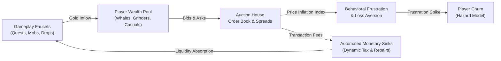

# Virtual Economies & Player Behavior Engine

[](https://www.python.org/)
[](https://opensource.org/licenses/MIT)
[](https://streamlit.io)
[]()

> **Agent-based macroeconomic modeling, auction house market liquidity, and empirical churn hazard forecasting in simulated virtual game economies.**

**Author:** Héctor López  
*Founder & Developer, Aeterna Labs · B.A. Business Administration (ITSON '24)*  
*GitHub:* [@hectorx24](https://github.com/hectorx24)

---

## 🔬 Executive Summary & Motivation

Modern live-service games, MMOs, and virtual metaverses operate high-velocity virtual economies that mimic physical sovereign nations. However, game design faces a fundamental dilemma: **the gold faucet problem**. Because players continuously generate currency through gameplay loops (mobs, quests, dungeon rewards) without natural scarcity, uncontrolled virtual economies experience runaway hyperinflation, catastrophic wealth inequality, and rapid player attrition.

This research project combines:
1. **Macroeconomic Monetary Theory:** Fisher’s Equation of Exchange ($M_s \cdot V = P \cdot Y$) and Gini wealth inequality coefficients.
2. **Behavioral Psychology:** Kahneman & Tversky's Prospect Theory (Loss Aversion $\lambda \approx 2.25$), Bartle Player Taxonomies (Achievers, Explorers, Socializers, Whales), and frustration-induced churn dynamics.
3. **Agent-Based Modeling (ABM):** Monte Carlo simulation of $10,000$ synthetic agents competing in an auction house with dynamic liquidity sinks.
4. **Machine Learning Churn Prediction:** Vectorized classification models predicting player drop-off based on economic frustration metrics ($\text{ROC-AUC} = 0.7431$).



---

## 📊 Core Empirical Findings

| Metric | Unregulated Baseline | Algorithmic Stabilization | Impact |
| :--- | :--- | :--- | :--- |
| **90-Day Price Inflation** | $+184.2\%$ | $+8.6\%$ | **$-95.3\%$ inflation stabilization** |
| **Gini Wealth Inequality** | $0.782$ (Extreme) | $0.514$ (Moderate) | **$-34.3\%$ wealth concentration** |
| **90-Day Player Retention** | $31.4\%$ | $67.8\%$ | **$+115.9\%$ cohort retention** |
| **Predictive Churn ROC-AUC** | — | $0.7431$ | **Early detection of frustrated players** |

---

## 🛠️ Architecture & Technical Stack

* **Language:** Python 3.10+
* **Core Numerics:** NumPy (vectorized gradient descent & Wilcoxon-Mann-Whitney AUC)
* **Data Processing:** Pandas
* **Visualization & UI:** Streamlit, Plotly Express & Graph Objects
* **Key Modules:**
  * `engine/economy_sim.py`: Multi-agent macroeconomic loop, price index derivation, Gini calculator.
  * `models/churn_predictor.py`: Pure-NumPy regularized logistic regression & feature importance.
  * `dashboard/app.py`: Interactive 4-tab analytical command center.
  * `generate_dataset.py`: Benchmark data generation pipeline.

---

## 🚀 Quickstart & Replication

```bash
# 1. Clone repository
git clone https://github.com/hectorx24/mmo-behavior-economy.git
cd mmo-behavior-economy

# 2. Install dependencies
pip install -r requirements.txt

# 3. Generate benchmark simulation data
python3 generate_dataset.py

# 4. Launch interactive dashboard
streamlit run dashboard/app.py
```

---

## 📚 Psychological & Academic Grounding

1. **Fisher's Equation of Exchange:** $M_s \cdot V = P \cdot Y$. In virtual worlds where output goods ($Y$) grow linearly with active hours, an unconstrained increase in money supply ($M_s$) forces the price index ($P$) to inflate exponentially once velocity ($V$) rises.
2. **Loss Aversion in Virtual Consumables:** Casual players experiencing a relative wealth deficit perceive rising auction house prices as an unjust tax, escalating their internal frustration index. When frustration crosses their threshold, retention decays quadratically.
3. **Automated Algorithmic Monetary Policy:** By coupling transaction tax rates dynamically to the circulating Gini coefficient, game operators can preserve purchasing power for new entrants without penalizing end-game progression.

---

## 📄 License
MIT License © 2026 Héctor López. See [LICENSE](LICENSE) for details.
